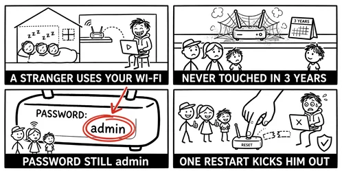
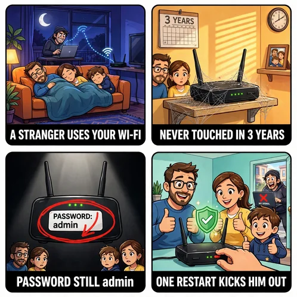
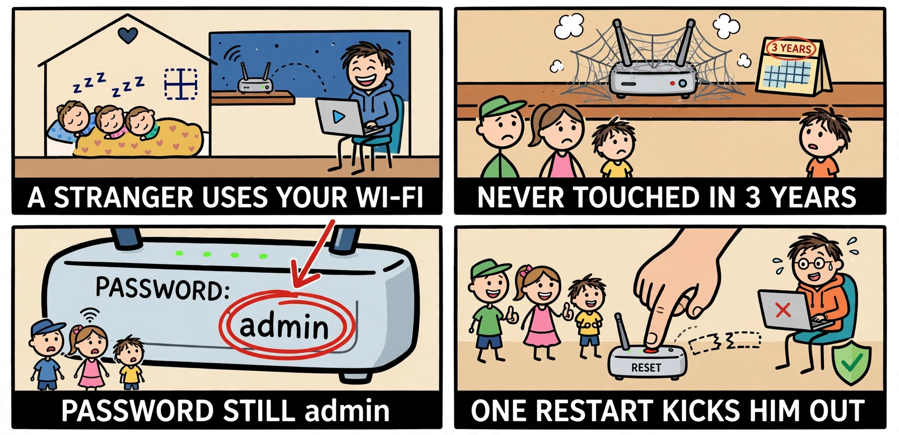
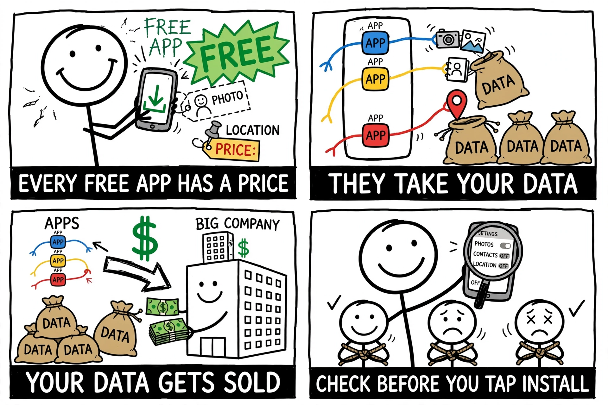
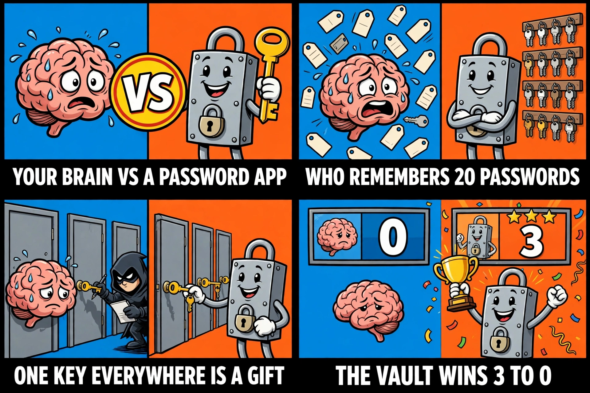

# Hexa StoryShorts

A portable AI skill that turns a topic or a rough script into a **complete faceless cartoon story-Short** — script, storyboard, scene prompts, narration and captions — in one of two house styles:

- **Style A — Whiteboard Doodle:** black-marker stick figures on white, exactly one red accent on the secret.
- **Style A-Color — Colorized Doodle:** the same doodle art, fully colorized — people, home and devices in flat, realistic colors.
- **Style B — Color Cartoon:** polished full-color cartoon, realistic object colors, and a **different background in every scene**.
- **Style C — Paint Explainer:** deliberately crude MS Paint look — wobbly lines, stick figures, hand-drawn labels — for "Every X…" explainers.
- **Style D — VS Comparison:** blue vs orange split frames, two rival characters, judged rounds and a scoreboard verdict ("X vs Y" titles earn ~2× the views).

Built on a simple, proven system: **one contrarian claim, one hidden mechanism, one small story in 4 beats — Shock → Cause → Mechanism → Payoff.** The same story, made in both styles:

| Style A — Whiteboard Doodle | Style B — Color Cartoon |
|---|---|
|  |  |

And the middle option — **Style A-Color**, the Style A board after its colorize pass:

Two more reference boards, each a different story:

| Style C — Paint Explainer | Style D — VS Comparison |
|---|---|
|  |  |

## How to use it (any AI)

1. Give your AI this repository (or paste `SKILL.md` + the `references/` folder into its context / skills folder).
2. Say what you want, for example:

   > "Use the hexa-storyshorts skill. Topic: why you should never charge your phone overnight. Style B."

   or with your own script:

   > "Use the hexa-storyshorts skill. Here is my script: [...]. Make it in Style A."

3. The AI returns the full package: title, 4-beat script with captions and narration, a storyboard, and one ready-to-paste image prompt per scene — then the production workflow in `references/production-workflow.md` takes it to a finished video.

Works with Claude (as a Skill), ChatGPT, Gemini, or any assistant that can read Markdown instructions.

## What's inside

- `SKILL.md` — the skill itself: inputs, workflow, output format, hard rules.
- `references/script-formula.md` — the 4-beat story system, caption and title rules, series logic.
- `references/style-a-whiteboard-doodle.md` — Style A spec + master prompts.
- `references/style-a-color-doodle.md` — Style A-Color: the colorize-pass system + prompt.
- `references/style-b-color-cartoon.md` — Style B spec + master prompts.
- `references/style-c-paint-explainer.md` — Style C spec + master prompts.
- `references/style-d-vs-comparison.md` — Style D spec + master prompts.
- `references/production-workflow.md` — storyboard → scenes → voice → captions → assembly → QC checklist.
- `examples/router-example.md` — one complete worked example in both styles.

## The idea in one line

People don't share facts; they share the moment a hidden mechanism clicks. Every StoryShort is built to deliver exactly one of those moments — in about 50 seconds, with the shock in the first frame and the fix in the last.

## License

MIT — see `LICENSE`. Use it, remix it, ship videos with it.
